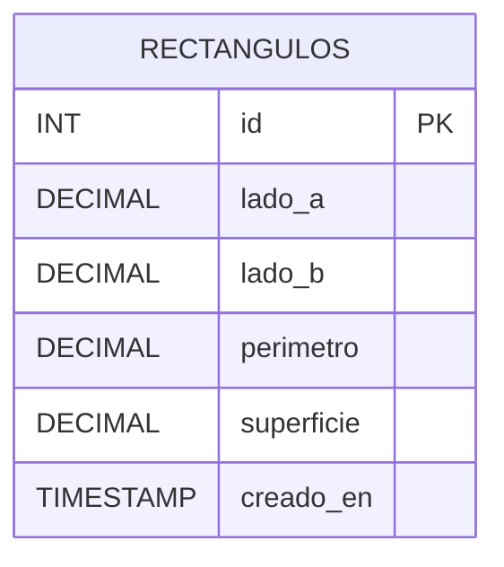

# Ejercicio 1 — Rectángulos

API con ExpressJS para administrar rectángulos, persistiendo la
información en MySQL.

## Diagrama entidad-relación



Una única entidad, sin relaciones: cada fila es un rectángulo
autocontenido, no hay necesidad de tablas auxiliares para este ejercicio.

## Recursos y métodos

| Método | Recurso             | Descripción                                      |
|--------|----------------------|---------------------------------------------------|
| GET    | `/rectangulos`       | Lista todos los rectángulos guardados              |
| GET    | `/rectangulos/:id`   | Devuelve un rectángulo puntual                     |
| POST   | `/rectangulos`       | Crea un rectángulo a partir de sus lados           |
| PUT    | `/rectangulos/:id`   | Reemplaza los lados de un rectángulo existente     |
| DELETE | `/rectangulos/:id`   | Elimina un rectángulo                              |

## Decisiones de diseño

- **Modelo de datos**: se almacenan `lado_a`, `lado_b`, `perimetro` y
  `superficie`, tal como exige el enunciado. `perimetro` y `superficie`
  son columnas igual que los lados (no se recalculan en cada lectura)
  porque el enunciado pide explícitamente que se almacenen, no solo
  que se puedan derivar.
- **Cálculo en el servidor, nunca en el cliente**: el body de
  `POST`/`PUT` solo admite `lado_a` y `lado_b`. Si el cliente manda
  `perimetro` o `superficie`, esos campos simplemente se ignoran — el
  controlador los recalcula siempre a partir de los lados antes de
  persistir. Esto evita inconsistencias (que alguien guarde un
  perímetro que no corresponde a los lados reales).
- **PUT en vez de PATCH**: cada modificación reemplaza ambos lados a
  la vez (no se contempla actualizar un solo lado de forma parcial),
  por lo que PUT (reemplazo completo del recurso) es semánticamente
  más correcto que PATCH.
- **`esCuadrado` como dato de respuesta, no de la base**: es
  completamente derivable de `lado_a === lado_b` en el momento de
  responder, así que no se persiste — persistirlo sería redundante y
  abriría la puerta a que quede desincronizado de los lados reales.
- **Validaciones con express-validator**:
  - `lado_a` y `lado_b`: requeridos, numéricos, estrictamente mayores
    a 0 (`isFloat({ gt: 0 })`).
  - `:id` en los params: debe ser un entero positivo (`isInt({ gt: 0 })`);
    si no lo es, se responde `400` antes de siquiera consultar la base.
  - Si el `id` es válido como número pero no existe en la base, se
    responde `404` (eso ya no es un problema de validación de formato,
    sino de existencia del recurso).
- **Pool de conexiones MySQL** (`mysql2/promise`) en vez de abrir una
  conexión nueva por request, que es el patrón recomendado para una
  API que atiende múltiples requests concurrentes.

## Cómo correrlo

1. Crear la base y la tabla ejecutando `schema.sql` en MySQL.
2. Copiar `.env.example` a `.env` y completar las credenciales si
   difieren de las de ejemplo.
3. Instalar dependencias y levantar el servidor:

   ```bash
   npm install
   npm start
   ```

Servidor por defecto en `http://localhost:3000`. Ver `rectangulos.http`
para casos de prueba (válidos e inválidos) de los cinco endpoints.
