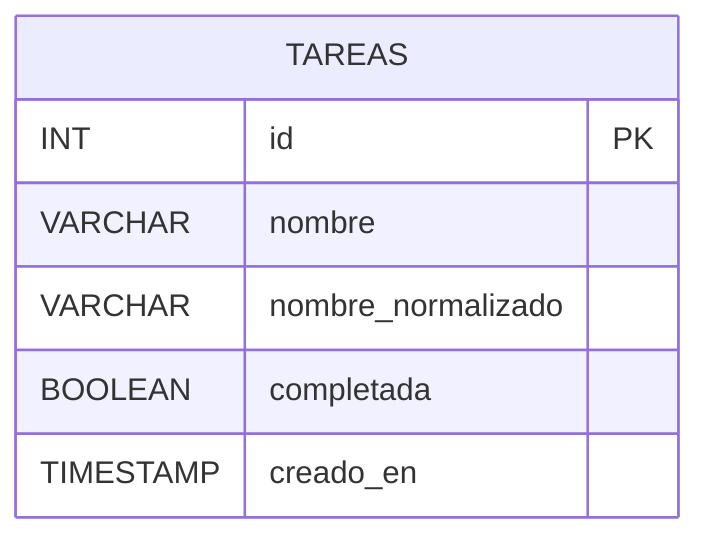

# Ejercicio 2 — Tareas

API con ExpressJS para administrar una lista de tareas y su estado de
avance, persistiendo en MySQL.

## Diagrama entidad-relación



Una única entidad, sin relaciones con otras tablas.

## Recursos y métodos

| Método | Recurso                        | Descripción                                    |
|--------|----------------------------------|--------------------------------------------------|
| GET    | `/tareas`                        | Lista todas las tareas                           |
| GET    | `/tareas?completada=true\|false` | Filtra por estado (completadas o pendientes)     |
| GET    | `/tareas/:id`                    | Devuelve una tarea puntual                       |
| POST   | `/tareas`                        | Crea una tarea. Body: `{ nombre }`               |
| PATCH  | `/tareas/:id`                    | Modifica nombre y/o estado de una tarea          |
| DELETE | `/tareas/:id`                    | Elimina una tarea                                |

## Decisiones de diseño

- **Criterio de comparación de nombres (consistente y documentado):**
  dos nombres se consideran la misma tarea si, al pasarlos a minúsculas
  y quitarles los espacios del principio/final, quedan idénticos. Por
  ejemplo, `"Lavar platos"`, `"lavar platos"` y `"  Lavar Platos  "`
  se tratan como el mismo nombre. Se eligió este criterio porque una
  comparación exacta (sensible a mayúsculas y espacios) permitiría
  duplicados "casi iguales" que en la práctica son la misma tarea para
  quien usa la API.
- **Doble resguardo de unicidad**: la comparación se aplica primero en
  la API (`express-validator` con un `custom` async que consulta la
  base) para devolver un `400` claro y específico; y además la columna
  `nombre_normalizado` tiene una restricción `UNIQUE` en la base de
  datos, que actúa como última barrera ante una posible condición de
  carrera (dos requests casi simultáneos). Si esa restricción llegara
  a dispararse, el manejador de errores la traduce a `409 Conflict`.
- **`nombre` se guarda tal cual lo escribió el usuario** (no
  normalizado) para no perder el formato original al mostrarlo, pero
  la columna auxiliar `nombre_normalizado` es la que se usa para
  comparar.
- **GET con query param `completada`** en vez de sub-recursos (ej.
  `/tareas/completadas`): se mantiene un único recurso `/tareas` y se
  trata el estado como un atributo filtrable, lo cual es más RESTful y
  evita duplicar rutas para algo que es, en esencia, un filtro.
- **PATCH en vez de PUT** para modificar: tanto `nombre` como
  `completada` son opcionales de forma independiente (se puede marcar
  una tarea como completada sin reenviar el nombre, o renombrarla sin
  tocar el estado), que es exactamente la semántica de una
  actualización parcial.
- **Validaciones con express-validator**:
  - `nombre` (al crear): requerido, string no vacío, máximo 150
    caracteres, y único según el criterio de comparación definido.
  - `nombre` (al modificar): mismas reglas, pero opcional; la
    verificación de unicidad excluye a la propia tarea que se está
    editando.
  - `completada` (al modificar): opcional, pero si viene debe ser
    estrictamente booleano.
  - `completada` (como filtro en la query): solo admite los strings
    `"true"` o `"false"`; cualquier otro valor se rechaza con `400`.
  - `:id` en los params: entero positivo.

## Cómo correrlo

1. Ejecutar `schema.sql` en MySQL (usa la misma base `programacion4`
   del Ejercicio 1; si no existe, el script también la crea).
2. Copiar `.env.example` a `.env` y completar las credenciales.
3. Instalar dependencias y levantar el servidor:

   ```bash
   npm install
   npm start
   ```

Servidor por defecto en `http://localhost:3000`. Ver `tareas.http` para
casos de prueba de los cinco endpoints, incluyendo los de duplicados y
filtros inválidos.
