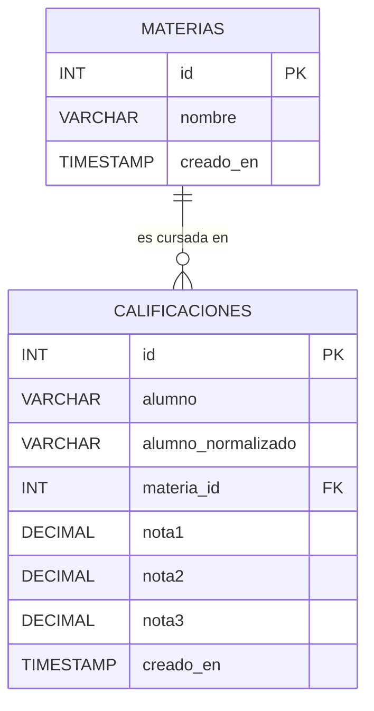

# Ejercicio 3 — Calificaciones

API con ExpressJS para gestionar alumnos, materias y calificaciones,
persistiendo en MySQL.

## Diagrama entidad-relación



Una materia puede tener muchas calificaciones (una por cada alumno que
la cursó); cada calificación pertenece a exactamente una materia.

## Recursos y métodos

| Método | Recurso                 | Descripción                                          |
|--------|---------------------------|--------------------------------------------------------|
| GET    | `/materias`                | Lista todas las materias                              |
| GET    | `/materias/:id`             | Devuelve una materia puntual                          |
| POST   | `/materias`                | Crea una materia. Body: `{ nombre }`                  |
| DELETE | `/materias/:id`             | Elimina una materia (si no tiene calificaciones)      |
| GET    | `/calificaciones`           | Lista todas las calificaciones                        |
| GET    | `/calificaciones/:id`       | Devuelve una calificación puntual                     |
| POST   | `/calificaciones`           | Crea una calificación. Body: `{ alumno, materiaId, notas }` |
| PATCH  | `/calificaciones/:id`       | Modifica alumno, materia y/o notas                    |
| DELETE | `/calificaciones/:id`       | Elimina una calificación                              |

## Decisiones de diseño

- **Materias como recurso independiente**: se expone `/materias` como
  su propio recurso (no solo como una tabla interna) porque el
  enunciado exige modelarlas en una tabla relacionada, y para poder
  referenciarlas por `materiaId` al crear una calificación primero
  tienen que poder crearse. Se usó `DELETE ... ON DELETE RESTRICT` en
  la clave foránea para impedir borrar una materia que todavía tiene
  calificaciones asociadas (se devuelve `409 Conflict`).
- **`calificaciones.materia_id` como clave foránea**: cumple
  directamente con "las materias deben... relacionarse con los
  registros de alumnos mediante una clave foránea".
- **Escala de notas: 1 a 10** (documentada acá y validada tanto por
  `express-validator` como por una restricción `CHECK` en la base, como
  segunda barrera).
- **Exactamente 3 notas**: `notas` se valida como un array de longitud
  exactamente 3, cada elemento numérico y dentro de la escala. Se
  eligió representarlas como array en el body porque es más natural
  para el cliente que mandar `nota1`, `nota2`, `nota3` sueltos, aunque
  internamente se guarden en columnas separadas.
- **Criterio de comparación del alumno**: igual que en el Ejercicio 2
  (minúsculas, sin espacios al borde), para que la regla de unicidad
  "alumno-materia" no se pueda esquivar escribiendo el nombre con
  mayúsculas o espacios distintos.
- **Unicidad de la combinación alumno-materia**: se valida en la API
  con un `custom` async de `express-validator` (devuelve `400` con
  mensaje claro) y además con una restricción `UNIQUE` compuesta
  (`alumno_normalizado`, `materia_id`) en la base, como resguardo ante
  condiciones de carrera (traducido a `409` en el manejador de
  errores).
- **Verificación de existencia de la materia**: `materiaId` se valida
  con un `custom` que consulta la tabla `materias`; si no existe,
  `400` antes de intentar el `INSERT` (que de todas formas fallaría
  por la clave foránea, pero así el mensaje es específico y entendible).
- **PATCH para modificar**: alumno, materia y notas son todos
  opcionales de forma independiente — se puede, por ejemplo, corregir
  solo una nota sin reenviar el resto. Si se cambia el alumno o la
  materia, se vuelve a validar la unicidad de la combinación resultante
  (excluyendo el propio registro).
- **Respuesta con la materia "expandida"**: las respuestas devuelven
  `materia: { id, nombre }` en vez de solo el id crudo, mediante un
  `JOIN`, porque es más útil para quien consume la API no tener que
  hacer una segunda consulta para saber el nombre de la materia.

## Cómo correrlo

1. Ejecutar `schema.sql` en MySQL (usa la misma base `programacion4`
   de los ejercicios anteriores).
2. Copiar `.env.example` a `.env` y completar las credenciales. Por
   defecto corre en el puerto **3002** (distinto a los Ejercicios 1 y
   2) para poder tener los tres servidores levantados a la vez sin que
   choquen entre sí.
3. Instalar dependencias y levantar el servidor:

   ```bash
   npm install
   npm start
   ```

Ver `calificaciones.http` para casos de prueba de ambos recursos,
incluyendo materia inexistente, notas fuera de escala, y combinación
alumno-materia duplicada.
